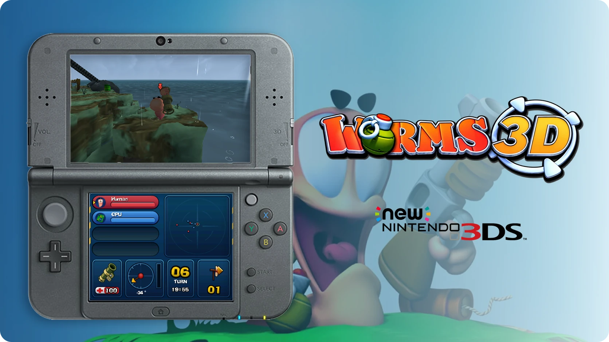
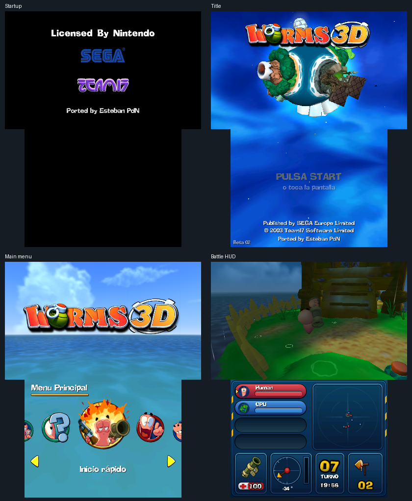
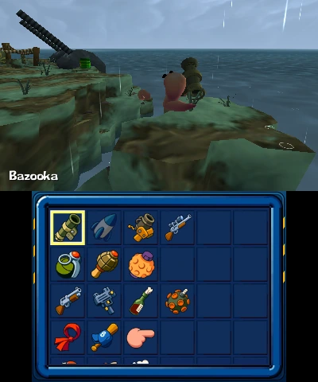
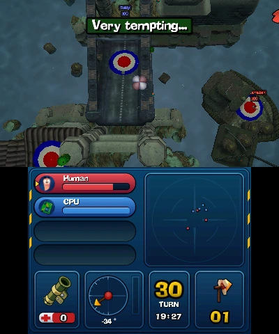

<h1 align="center">Worms 3DS</h1>

  <strong>Take your squad into battle.</strong> 
  Worms 3D, adapted for two screens on New Nintendo 3DS.

  <a href="https://github.com/EstebanPdN/worms-3ds/releases/tag/beta-02">Download</a> ·
  <a href="#features">Features</a> ·
  <a href="#screenshots">Screenshots</a> ·
  <a href="#documentation">Documentation</a> ·
  <a href="https://github.com/EstebanPdN/worms-3ds/releases/tag/beta-02">Changelog</a> ·
  <a href="#community-and-bug-reports">Community</a>

  
  

  

  
  
  

This is my native New Nintendo 3DS port of the GameCube version of *Worms 3D*. I started by recovering the GameCube code in [my Worms 3D decompilation project](https://github.com/EstebanPdN/worms-3d-decomp). I'm still testing matches and performance in the public beta.

This project was developed with the help of [OpenAI Codex](https://openai.com/codex/) and [Claude Code](https://claude.com/product/claude-code). Learn more about the development process [here](AI_DEVELOPMENT.md).

## Features

<table>
  <tr>
    <td width="50%" valign="top"><strong>Start a quick match</strong> Take your team into a 3D battlefield on the upper screen.</td>
    <td width="50%" valign="top"><strong>Keep the radar close</strong> The lower screen shows team slots, health, the turn timer and the radar during a match.</td>
  </tr>
  <tr>
    <td width="50%" valign="top"><strong>Pick your weapon</strong> Open the lower-screen inventory to see what's available for the current turn.</td>
    <td width="50%" valign="top"><strong>Bring your own mods</strong> Load compatible local <code>.worms</code> packs from the SD card.</td>
  </tr>
</table>

## Download and installation

[Download beta-02](https://github.com/EstebanPdN/worms-3ds/releases/tag/beta-02). The release includes the CIA, Homebrew Launcher build, FBI QR code and SHA-256 checksums.

### Requirements

- **New Nintendo 3DS, New Nintendo 3DS XL, or New Nintendo 2DS XL**.
- Your own European/PAL *Worms 3D* GameCube disc (`GWMP8P`, revision 0).
- Allow 1 GiB of free space on the SD card for `assets.worms`.

### Prepare the game data

1. Open [Forge 3DS Converter 1.2.0](https://github.com/EstebanPdN/estebanpdn.github.io/releases/tag/forge-3ds-converter-v1.2.0), select **Worms 3D**, and choose the ISO dumped from your own disc.
2. When the converter reports **Game data verified**, copy `assets.worms` to `sdmc:/3ds/worms3ds/assets.worms`.

### CIA / FBI

Install the CIA from your SD card with FBI, or use **Remote Install → Scan QR Code** with the QR on the [beta-02 release page](https://github.com/EstebanPdN/worms-3ds/releases/tag/beta-02).

### Homebrew Launcher / 3DSX

Put `Worms-3D-beta-02.3dsx` in `sdmc:/3ds/worms3ds/` alongside `assets.worms`, then launch it from the Homebrew Launcher.

### Optional local assets

Put compatible `.worms` mod packs in `sdmc:/3ds/worms3ds/mods/` for additional game content. The CIA and 3DSX include the full two-screen interface. Your existing PAL `assets.worms` works with beta-02.

## Screenshots

  
  

## Documentation

- [Installation guide](https://estebanpdn.github.io/worms-3d.html#install)
- [Beta-02 changelog](https://github.com/EstebanPdN/worms-3ds/releases/tag/beta-02)
- [AI development notes](AI_DEVELOPMENT.md)

## Community and bug reports

[Join the project Discord](https://discord.com/servers/esteban-s-forge-1533248895663210506) for updates, testing and suggestions. [Open an issue](https://github.com/EstebanPdN/worms-3ds/issues) with your console model, launcher, build number, map, game mode and the steps to reproduce the issue. For conversion problems, include the disc ID and the converter's error message.

With **Developer → Debug buttons** enabled, press and release **SELECT** to save a diagnostic report under `sdmc:/3ds/worms3ds/dumps/`. Keep game files, saves and dumps out of public issues.

## Credits

*Worms 3D* and its artwork belong to Team17 and their respective rights holders. Nintendo 3DS is a trademark of Nintendo. I distribute the port builds separately from the original game data. [New Nintendo 3DS wordmark reference](https://commons.wikimedia.org/wiki/File:New_Nintendo_3DS_logo.svg)
